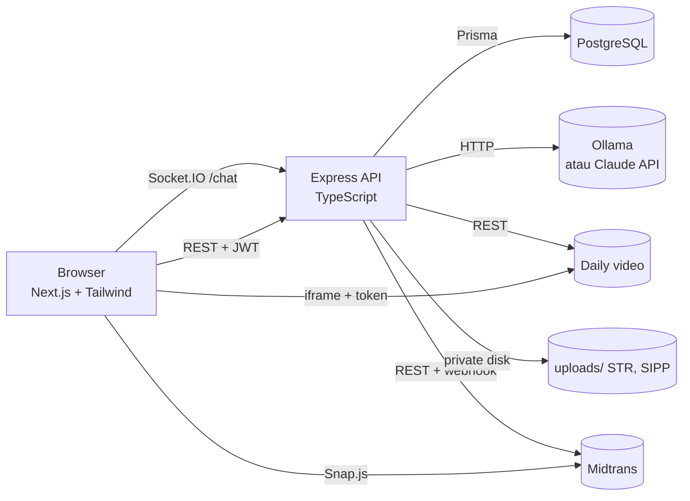

# Ruang Pulih — Konsultasi Psikolog Online dengan Asisten AI (MVP)

Platform untuk booking sesi dengan **psikolog terverifikasi**, dengan **AI sebagai pendamping awal** (bukan pengganti psikolog).

> **AI ini bukan psikolog dan bukan layanan darurat.** Dalam keadaan darurat hubungi **119 ext. 8** (Hotline Kesehatan Jiwa Kemenkes) atau **112**.

## Daftar isi
1. [Fitur](#fitur)
2. [Arsitektur](#arsitektur)
3. [Menjalankan secara lokal](#menjalankan-secara-lokal)
4. [Variabel lingkungan](#variabel-lingkungan)
5. [Pengujian](#pengujian)
6. [Keamanan & privasi](#keamanan--privasi)
7. [Deployment](#deployment)
8. [Keterbatasan MVP](#keterbatasan-mvp)

---

## Fitur

| Peran | Fitur |
|---|---|
| **Pengunjung** (tanpa akun) | Tes mandiri *Temukan Dirimu*, cari & lihat profil psikolog |
| **Pengguna** | Registrasi/login, chat AI pendamping (tersimpan / tanpa simpan), pra-asesmen PHQ-9 & GAD-7, ringkasan keluhan + rekomendasi psikolog, tes *Temukan Dirimu* dengan riwayat hasil & penjelasan AI, booking & bayar (Midtrans), chat real-time & video call (Daily), berbagi ringkasan ke psikolog per sesi, riwayat sesi, atur persetujuan, unduh & hapus data |
| **Psikolog** | Profil & spesialisasi, unggah STR/SIPP, atur slot jadwal, daftar sesi, lihat ringkasan pra-asesmen (jika dibagikan), catatan sesi terenkripsi, ruang sesi |
| **Admin** | Ringkasan laporan, kelola pengguna (tangguhkan/aktifkan), verifikasi psikolog, log insiden krisis (tanpa isi percakapan), antrean refund, audit log |

**AI (default: model open-source lewat [Ollama](https://ollama.com), gratis & self-hosted; opsional Claude; hanya dipanggil dari backend):** pendamping empatik + psikoedukasi; dilarang mendiagnosis, menyebut obat, atau mengaku terapis. Deteksi krisis dua lapis (kata kunci deterministik → classifier LLM); jika terdeteksi, respons AI dihentikan, kontak darurat dan tombol *booking segera* ditampilkan, dan insiden dicatat tanpa isi pesan.

**Temukan Dirimu (`/discover`):** tes refleksi diri yang bisa diikuti tanpa login. Skor dihitung di server; hasil hanya disimpan (terenkripsi, tanpa jawaban per butir) bila pengguna login dan menyetujui `STORE_ASSESSMENT`. Penjelasan AI opsional hanya menerima skor hasil.

| Tema | Tes | Sumber |
|---|---|---|
| Tipe kepribadian | Big Five (20 butir) | Mini-IPIP dari International Personality Item Pool (domain publik) |
| Tipe kepribadian | 16 tipe 4 huruf (20 butir) | Butir & deskripsi orisinal; **bukan** MBTI® resmi |
| Trauma masa lalu | ACE (10) + PC-PTSD-5 (1 + 5 kondisional) | ACE (Felitti dkk., 1998), PC-PTSD-5 (US VA, domain publik) |
| Gangguan hati | Patah hati (10 butir, butir 10 = keselamatan → panel krisis + insiden `SELF_TEST_ITEM`) | Skala refleksi orisinal, belum tervalidasi klinis |
| Bahasa cinta | 20 pasangan pilihan | Terinspirasi konsep Gary Chapman; butir orisinal, **bukan** kuis resmi |

Definisi tes ada di `backend/src/modules/discover/tests/`; menambah tes cukup dengan file definisi baru + nilai enum `SelfTestType` di Prisma.

## Arsitektur



```
PSIKOLOG/
├─ docker-compose.yml          # PostgreSQL lokal
├─ backend/
│  ├─ prisma/                  # schema.prisma, migrations/, seed.ts
│  ├─ src/
│  │  ├─ config/env.ts         # validasi env (zod)
│  │  ├─ lib/                  # crypto, jwt, llm (Ollama/Claude), daily, midtrans, storage, audit
│  │  ├─ middleware/           # auth/RBAC, validate, rateLimit, upload, error
│  │  ├─ modules/              # auth, users, consents, psychologists, bookings,
│  │  │                        # payments, chat, video, ai, discover, admin
│  │  ├─ sockets/              # Socket.IO /chat
│  │  └─ jobs/                 # pelepasan slot yang tidak dibayar
│  ├─ tests/                   # Vitest (unit + HTTP)
│  └─ Dockerfile
└─ frontend/
   └─ src/
      ├─ app/                  # halaman (user, psychologist, admin, session, ai-chat, ...)
      ├─ components/
      └─ lib/                  # api client, auth context, socket, types
```

## Menjalankan secara lokal

### Prasyarat
- Node.js 20+ (diuji di 22)
- Docker Desktop (untuk PostgreSQL) **atau** PostgreSQL 14+ lokal
- [Ollama](https://ollama.com/download) untuk fitur AI (gratis, berjalan lokal; RAM ≥ 8 GB, GPU opsional)
- Opsional: akun [Anthropic](https://console.anthropic.com) (pengganti Ollama), [Daily](https://dashboard.daily.co), [Midtrans Sandbox](https://dashboard.sandbox.midtrans.com)

### Langkah

```powershell
# 1. Database
docker compose up -d

# 2. AI (Ollama). Unduh model sekali (~3 GB); server Ollama berjalan di http://localhost:11434
ollama pull gemma3:4b

# 3. Backend
cd backend
npm install
copy .env.example .env          # lalu isi nilai (lihat tabel di bawah)
npx prisma migrate deploy       # atau: npx prisma migrate dev
npm run seed                    # admin + 10 spesialisasi
npm run dev                     # http://localhost:4000

# 4. Frontend (terminal baru)
cd frontend
npm install
copy .env.example .env.local
npm run dev                     # http://localhost:3000
```

Membuat secret acak untuk `.env`:

```powershell
node -e "console.log(require('crypto').randomBytes(48).toString('base64'))"   # JWT_ACCESS_SECRET
node -e "console.log(require('crypto').randomBytes(32).toString('base64'))"   # DATA_ENCRYPTION_KEYS (1:<nilai>)
```

> Jika sebelumnya sudah menjalankan `migrate dev` dengan nama migrasi lain, reset database dev dengan `npx prisma migrate reset`.

**Memilih model Ollama.** Default `gemma3:4b` (bahasa Indonesia cukup baik, ringan untuk CPU). Tanpa GPU, satu balasan bisa memakan 20–60 detik; dengan RAM/GPU lebih besar gunakan model yang lebih kuat, mis. `gemma3:12b` atau `qwen2.5:7b`, lalu set `OLLAMA_MODEL`. Hindari model *reasoning* (mis. `qwen3`, `deepseek-r1`) karena proses berpikirnya menghabiskan batas token classifier. Untuk menyimpan model di drive lain, set variabel lingkungan Windows `OLLAMA_MODELS` (mis. `D:\ollama\models`) lalu restart Ollama.

### Alur uji manual
1. Login admin (`SEED_ADMIN_EMAIL` / `SEED_ADMIN_PASSWORD`).
2. Daftar sebagai **psikolog** → isi profil → unggah STR & SIPP.
3. Admin → *Verifikasi* → verifikasi psikolog.
4. Psikolog → *Jadwal* → tambah slot.
5. Daftar sebagai **pengguna** → *Pra-asesmen* → *Cerita dengan AI* → *Cari psikolog* → booking → bayar (kartu uji sandbox Midtrans, mis. `4811 1111 1111 1114`, CVV `123`, OTP `112233`).
6. Pada jam sesi, kedua pihak masuk *Ruang sesi* (chat + video).

Tanpa webhook publik, status pembayaran tetap diperbarui lewat tombol bayar (endpoint `/sync`). Untuk menguji webhook: `ngrok http 4000` lalu set *Payment Notification URL* Midtrans ke `https://<ngrok>/api/v1/payments/midtrans/notification`.

## Variabel lingkungan

### Backend (`backend/.env`)

| Variabel | Wajib | Keterangan |
|---|---|---|
| `NODE_ENV` | – | `development` / `production` / `test` |
| `PORT` | – | Default `4000` |
| `CORS_ORIGIN` | ✓ | Origin frontend, pisahkan koma bila lebih dari satu |
| `TRUST_PROXY` | – | `1` jika di belakang reverse proxy/load balancer |
| `DATABASE_URL` | ✓ | Connection string PostgreSQL |
| `JWT_ACCESS_SECRET` | ✓ | ≥ 32 karakter acak |
| `ACCESS_TOKEN_TTL` | – | Default `15m` |
| `REFRESH_TOKEN_TTL_DAYS` | – | Default `7` |
| `DATA_ENCRYPTION_KEYS` | ✓ | `versi:base64key` (32 byte), dipisah koma untuk rotasi, mis. `1:abc...,2:def...` |
| `DATA_ENCRYPTION_KEY_CURRENT` | ✓ | Versi kunci untuk enkripsi baru |
| `IP_HASH_SALT` | ✓ | Salt hash IP pada audit log |
| `POLICY_VERSION` | ✓ | Versi kebijakan privasi yang disetujui pengguna |
| `UPLOAD_DIR` | – | Folder privat dokumen STR/SIPP (default `uploads`) |
| `SEED_ADMIN_EMAIL`, `SEED_ADMIN_PASSWORD` | seed | Akun admin awal |
| `AI_PROVIDER` | – | `ollama` (default, gratis) atau `anthropic` |
| `OLLAMA_BASE_URL` | AI | Default `http://localhost:11434`; kosongkan untuk menonaktifkan AI (503) |
| `OLLAMA_MODEL` | – | Default `gemma3:4b` (harus sudah di-`ollama pull`) |
| `OLLAMA_NUM_CTX` | – | Panjang konteks, default `8192` (agar system prompt tidak terpotong) |
| `OLLAMA_TIMEOUT_MS` | – | Default `120000`; naikkan bila model lambat di CPU |
| `ANTHROPIC_API_KEY` | AI* | Wajib bila `AI_PROVIDER=anthropic`; tanpa ini fitur AI mengembalikan 503 |
| `ANTHROPIC_MODEL` | – | Default `claude-sonnet-4-6` |
| `DAILY_API_KEY` | video | Tanpa ini video mengembalikan 503 |
| `MIDTRANS_SERVER_KEY` | bayar | Server key (sandbox: `SB-Mid-server-...`) |
| `MIDTRANS_IS_PRODUCTION` | – | `false` (sandbox) / `true` |

### Frontend (`frontend/.env.local`)

| Variabel | Keterangan |
|---|---|
| `NEXT_PUBLIC_API_URL` | URL API, mis. `http://localhost:4000/api/v1` |
| `NEXT_PUBLIC_MIDTRANS_CLIENT_KEY` | Client key Midtrans (publik by design) |
| `NEXT_PUBLIC_MIDTRANS_SNAP_URL` | `https://app.sandbox.midtrans.com/snap/snap.js` (produksi: `https://app.midtrans.com/snap/snap.js`) |

**Secret hanya di backend.** Tidak ada API key AI/Daily/Midtrans server di frontend.

> Teks persetujuan AI di frontend (`ai-chat/page.tsx`, `settings/privacy/page.tsx`) menyebut Ollama di server platform. Jika beralih ke `AI_PROVIDER=anthropic`, perbarui teks tersebut karena data akan dikirim ke pihak ketiga.

## Pengujian

```powershell
cd backend
npm test            # Vitest: 94 tes unit + HTTP, tanpa database (Prisma di-mock)
npm run typecheck
cd ../frontend
npm run build       # type-check + build Next.js
```

Cakupan tes: enkripsi & rotasi kunci, deteksi kata kunci krisis (positif & negatif palsu), filter output AI, tanda tangan riwayat chat, skoring PHQ-9/GAD-7, skoring & validasi jawaban tes Temukan Dirimu, signature Midtrans, jendela sesi, autentikasi/RBAC, validasi input, batas ukuran body, consent AI, alur krisis (insiden dicatat tanpa isi pesan), dan penolakan webhook palsu.

Belum otomatis (uji manual): integrasi nyata Ollama/Claude/Daily/Midtrans dan alur end-to-end dengan database.

## Keamanan & privasi

| Aspek | Implementasi |
|---|---|
| Autentikasi | JWT akses 15 menit (memori) + refresh token acak di cookie `httpOnly SameSite=Strict`, dirotasi, deteksi reuse |
| RBAC | `requireRole()` di setiap route + cek kepemilikan resource (404 untuk resource milik orang lain) |
| Enkripsi saat disimpan | AES-256-GCM per kolom: chat AI, pesan sesi, asesmen, ringkasan, catatan sesi, nomor STR/SIPP; rotasi kunci didukung |
| Enkripsi saat dikirim | HTTPS/WSS di produksi (cookie `Secure`, HSTS via helmet) |
| Consent | `TERMS_PRIVACY`, `AI_PROCESSING`, `STORE_AI_CHAT`, `STORE_ASSESSMENT`, `SHARE_ASSESSMENT` (per booking). Mencabut consent penyimpanan langsung menghapus datanya |
| UU PDP | Minimisasi data (keluhan mentah dan jawaban per butir tes Temukan Dirimu tidak disimpan, Midtrans hanya menerima nama depan), hak akses (`GET /users/me/export`), hak hapus (`DELETE /users/me`), audit log untuk akses data sensitif |
| Prompt injection | System prompt hanya di server, input disanitasi, tidak ada tool, riwayat chat tanpa simpan ditandatangani HMAC, output terstruktur JSON untuk classifier/ringkasan, filter output |
| Rate limiting | Global 300/15 menit/IP, auth 5/menit, AI 20/menit/pengguna, chat sesi 10 pesan/10 detik |
| Validasi | zod di semua input; upload dicek magic bytes; body JSON maks. 100 KB |
| Insiden krisis | Hanya metadata (sumber, pemicu, kategori, risiko); kontak pengguna ditampilkan ke admin atas permintaan dan dicatat di audit log |

## Deployment

### Topologi yang disarankan
- **Frontend**: Vercel (atau container Node) di `https://app.domain.id`
- **Backend**: container dari `backend/Dockerfile` (Render, Railway, Fly.io, Cloud Run, atau VPS + Caddy/Nginx) di `https://api.domain.id`
- **Database**: PostgreSQL terkelola dengan enkripsi disk & backup harian (mis. Neon, Supabase, RDS, Cloud SQL)

> Frontend dan API harus berada di **site yang sama** (subdomain dari domain yang sama) agar cookie refresh `SameSite=Strict` terkirim.

### Backend (Docker)

```bash
cd backend
docker build -t ruang-pulih-api .
docker run -d -p 4000:4000 --env-file .env.production \
  -v ruang-pulih-uploads:/app/uploads ruang-pulih-api
```

Container menjalankan `prisma migrate deploy` lalu server. Jalankan seed sekali: `docker exec <container> npx prisma db seed` (atau buat admin manual).

Platform yang men-scale ke beberapa instance membutuhkan **Socket.IO Redis adapter** dan **storage objek** (S3/R2/GCS) sebagai pengganti `uploads/` lokal.

### Frontend (Vercel)
1. Import repo, root directory `frontend`.
2. Set `NEXT_PUBLIC_API_URL=https://api.domain.id/api/v1` dan variabel Midtrans produksi.

### Checklist produksi
- [ ] `NODE_ENV=production`, `TRUST_PROXY=1` jika di belakang proxy
- [ ] `CORS_ORIGIN` hanya domain frontend
- [ ] Secret baru (JWT, kunci enkripsi, salt) disimpan di secret manager, **bukan** di repo
- [ ] Backup kunci enkripsi terpisah dari backup database (kehilangan kunci = data tidak bisa dibaca)
- [ ] `MIDTRANS_IS_PRODUCTION=true`, server/client key produksi, Notification URL Midtrans → `https://api.domain.id/api/v1/payments/midtrans/notification`
- [ ] Domain Daily & API key produksi
- [ ] Ganti password admin seed; aktifkan 2FA di dashboard pihak ketiga
- [ ] Monitoring log (pino JSON) & alert untuk insiden krisis `OPEN`
- [ ] AI: jalankan Ollama di server yang sama/jaringan privat (jangan ekspos port 11434 ke publik) dan set `OLLAMA_BASE_URL`; atau gunakan `AI_PROVIDER=anthropic`
- [ ] Tinjau kebijakan privasi, perjanjian pemrosesan data dengan Daily/Midtrans (dan Anthropic bila dipakai), dan kepatuhan UU PDP (termasuk transfer data lintas negara)

## Keterbatasan MVP
- Refund diproses manual di dashboard Midtrans lalu ditandai di admin.
- Hapus akun mandiri hanya untuk peran pengguna; akun psikolog dihapus melalui admin/DB.
- Notifikasi (email/WA) untuk booking, pengingat sesi, dan insiden krisis belum ada.
- Classifier krisis bergantung pada ketersediaan model AI (Ollama/Claude); jika gagal, AI tidak membalas dan menampilkan info hotline.
- Model lokal kecil (mis. `gemma3:4b`) kurang akurat dibanding model besar untuk classifier krisis dan kepatuhan aturan; lapisan kata kunci deterministik tetap berjalan lebih dulu. Uji kualitasnya sebelum produksi.
- Belum ada tes E2E (Playwright) dan tes frontend.
- Skala *Patah Hati* dan 16 tipe kepribadian disusun sendiri dan belum divalidasi secara psikometri; adaptasi Indonesia untuk Mini-IPIP, ACE, dan PC-PTSD-5 juga belum divalidasi. Tinjau bersama psikolog sebelum produksi.
- Pengguna anonim yang masuk setelah menyelesaikan tes perlu mengulang tes agar hasilnya tersimpan.

---

*Dibangun sebagai proyek pribadi. Bukan perangkat medis dan tidak menggantikan layanan kesehatan jiwa profesional.*
